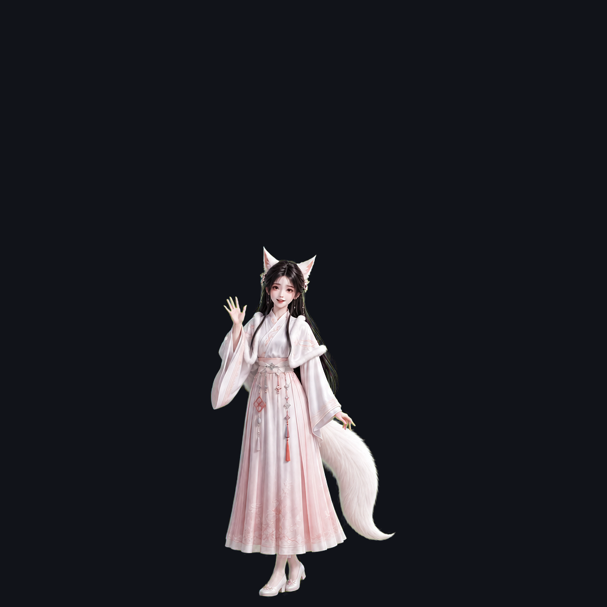

# 于曦桌面宠物

一个使用 AppKit 制作的 macOS 原生桌面宠物。透明置顶窗口中的角色可以拖动、挥手、散步、眨眼和休眠，菜单栏提供动作与大小控制。



## 构建

需要 macOS 13 或更新版本及 Xcode Command Line Tools。

```bash
./DesktopPet/build.sh
```

构建完成后，应用位于 `dist/于曦桌面宠物.app`。构建脚本会使用 `assets/character/sequences-v5/` 中的透明 PNG 帧序列。

## 实现要点

- AppKit 透明、无边框窗口与菜单栏控制。
- 12 帧行走、独立起停过渡和 8 帧自然待机动画。
- 通过脚底基线、重心起伏与接触阴影减少动画跳动。
- 交互无需麦克风、网络服务或第三方运行环境。

源代码与运行所需帧图保留在仓库中；构建缓存、应用包和发布压缩包不纳入版本控制。
